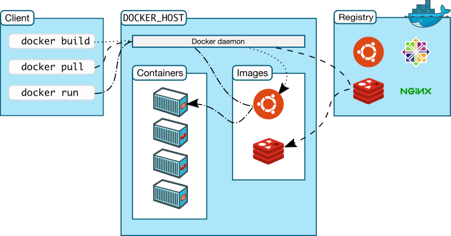
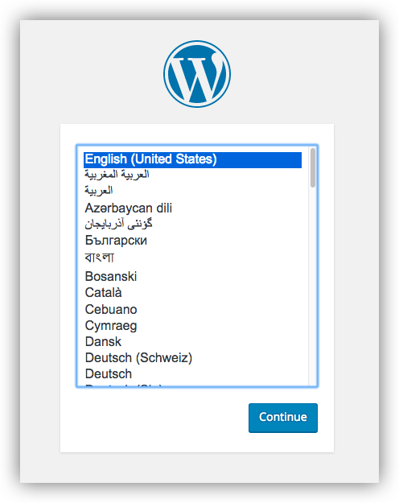

## 1. Docker Overview

### What is Docker?


Docker is an open-source containerization platform for packaging, shipping, and running applications reliably across environments.

### Why Use Docker?

- Isolation and separation of applications
- Standardized container creation and reproducible builds
- Container image versioning
- Shared container images across teams and registries

### Docker Architecture



- **Dockerfile:** Defines the instructions Docker uses to build container images automatically.
- **Docker Images:** Read-only templates containing application binaries, runtime libraries, and configuration needed to run a container.
- **Docker Containers:** Lightweight, isolated runtime instances created from images. Unlike full virtual machines, containers share the host OS kernel with significantly less overhead.
- **Docker Registry (Docker Hub):** A centralized storage and distribution service for named container images.
- **Docker Daemon:** The background service running on the host OS (`dockerd`) that builds, runs, and manages containers.

## 2. Installing Docker Engine on Ubuntu

Remove legacy packages if present:

```bash
sudo apt-get remove -y docker docker.io containerd runc
```

Install repository prerequisites:

```bash
sudo apt-get update
sudo apt-get install -y \
  apt-transport-https \
  ca-certificates \
  curl \
  gnupg \
  lsb-release
```

Add Docker's official GPG key and verify its fingerprint (`9DC8 5822 9FC7 DD38 854A E2D8 8D81 803C 0EBF CD88`):

```bash
curl -fsSL https://download.docker.com/linux/ubuntu/gpg | sudo apt-key add -
sudo apt-key fingerprint 0EBFCD88
```

Add the stable APT repository and install Docker Engine:

```bash
sudo add-apt-repository \
  "deb [arch=amd64] https://download.docker.com/linux/ubuntu \
  $(lsb_release -cs) \
  stable"

sudo apt-get update
sudo apt-get install -y docker-ce docker-ce-cli containerd.io
```

Enable and start the Docker service, then verify with `hello-world`:

```bash
sudo systemctl start docker
sudo systemctl enable docker
sudo docker run hello-world
```

### Sample Dockerfile Build

Create a working directory and a sample file:

```bash
mkdir -p ~/sample-dockerfile/ && cd ~/sample-dockerfile/
echo "I am learning docker" > learn-docker.txt
```

```dockerfile file=Dockerfile
FROM ubuntu:20.04
RUN apt update
RUN apt install iftop -y
COPY learn-docker.txt learn-docker.txt
```

Build and run the custom image:

```bash
docker build . -t learn-docker
docker run -it --name learn-docker learn-docker bash
ls
cat learn-docker.txt
```

## 3. Docker Compose

Docker Compose lets you define and run multi-container applications using a single YAML configuration file.

Install Docker Compose:

```bash
bash <(curl -s https://gist.githubusercontent.com/ufkunkaraman/72ecf0b56eb7b9758c16c82b3c717275/raw/219d7768e3898b5e6f3665d7e1a97eec562e6a46/docker-compose-installation.bash)
```

### Multi-Container Example: WordPress & MySQL

```yaml file=docker-compose.yaml
version: "3.9"

services:
  db:
    image: mysql:5.7
    volumes:
      - db_data:/var/lib/mysql
    restart: always
    environment:
      MYSQL_ROOT_PASSWORD: somewordpress
      MYSQL_DATABASE: wordpress
      MYSQL_USER: wordpress
      MYSQL_PASSWORD: wordpress

  wordpress:
    depends_on:
      - db
    image: wordpress:latest
    volumes:
      - wordpress_data:/var/www/html
    ports:
      - "8000:80"
    restart: always
    environment:
      WORDPRESS_DB_HOST: db
      WORDPRESS_DB_USER: wordpress
      WORDPRESS_DB_PASSWORD: wordpress
      WORDPRESS_DB_NAME: wordpress

volumes:
  db_data: {}
  wordpress_data: {}
```

Start the stack in detached mode:

```bash
docker-compose up -d
```

Open WordPress in your browser at `http://<your-machine-ip>:8000`:



## References

- [UpGuard: Docker vs LXC](https://www.upguard.com/blog/docker-vs-lxc)
- [IBM Cloud: Learn Docker](https://www.ibm.com/cloud/learn/docker)
- [TechTarget: Docker Image Definition](https://www.techtarget.com/searchitoperations/definition/Docker-image)
