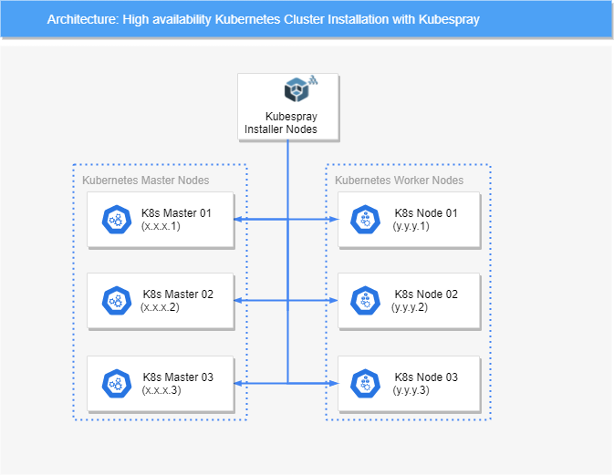
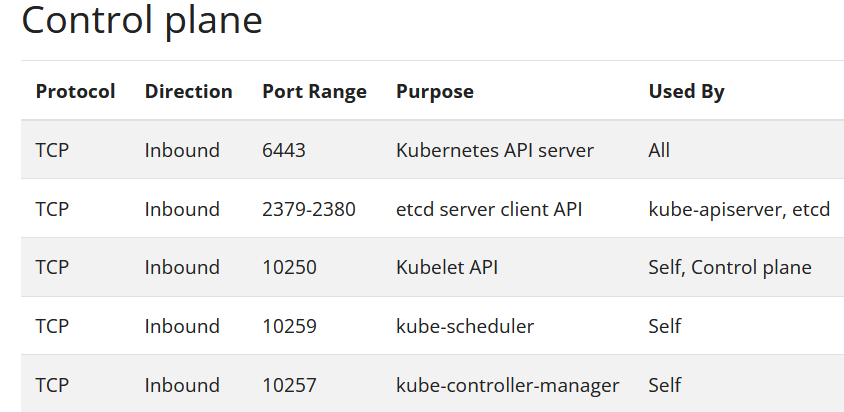
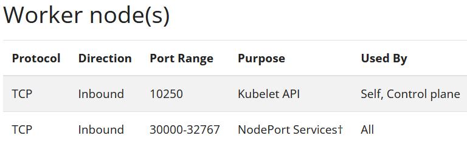

This guide walks through setting up a High Availability (HA) Kubernetes cluster on Ubuntu 20.04 VMs or bare-metal servers using Kubespray and Ansible.

## Prerequisites & Node Topology

- **3 VMs** for Kubernetes Control Plane / Master Nodes (Ubuntu 20.04)
- **3 VMs** for Kubernetes Worker Nodes (Ubuntu 20.04)
- **1 VM** for the Kubernetes Installer / Ansible Control Node (Ubuntu 20.04)



Example node layout:

- `K8s-Master-01` (`x.x.x.1` — Ubuntu 20.04)
- `K8s-Master-02` (`x.x.x.2` — Ubuntu 20.04)
- `K8s-Master-03` (`x.x.x.3` — Ubuntu 20.04)
- `K8s-Worker-01` (`y.y.y.1` — Ubuntu 20.04)
- `K8s-Worker-02` (`y.y.y.2` — Ubuntu 20.04)
- `K8s-Worker-03` (`y.y.y.3` — Ubuntu 20.04)

## 1. About Kubespray

This quickstart helps you install a Kubernetes cluster on bare metal, vSphere, OpenStack, AWS, GCP, Azure, or Oracle Cloud using [Kubespray](https://github.com/kubernetes-sigs/kubespray).

Kubespray combines [Ansible](https://docs.ansible.com/) playbooks, [inventory](https://github.com/kubernetes-sigs/kubespray/blob/master/docs/ansible.md) tooling, and production defaults for cluster lifecycle management. It provides:

- A highly available control plane and etcd quorum
- Composable attributes for CNI, proxy mode, and container runtime
- Support for popular Linux distributions (Ubuntu, RHEL/CentOS/Oracle Linux, Debian, Fedora, openSUSE, Flatcar)
- Continuous integration test coverage

## 2. Standard Linux OS Settings

Complete the baseline Linux preparation on every node first:

[Standard Configuration for Linux OS](/posts/standard-configuration-for-linux-os)

## 3. Prerequisites & System Configuration

### Install Required Packages

- **Install HWE Kernel (Masters & Workers):**

  > [!NOTE]
  > Hardware Enablement (HWE) provides newer Linux kernel and driver support on Ubuntu LTS releases.

  ```bash
  sudo apt-get install -y linux-image-generic-hwe-20.04
  ```

- **Install Python & Pip for Ansible (All Nodes):**

  ```bash
  sudo apt install -y python3 python3-pip
  ```

### Configure Operating System & SSH

- **Disable Swap (Masters & Workers):**

  ```bash
  sudo sed -i '/ swap / s/^\(.*\)$/#\1/g' /etc/fstab
  sudo sed -i 's/\/swap.img/#\/swap.img/g' /etc/fstab
  sudo swapoff -a
  ```

- **Generate SSH Key Pair (Installer Node):**

  ```bash
  ssh-keygen
  ```

  ```text
  Generating public/private rsa key pair.
  Enter file in which to save the key (/home/username/.ssh/id_rsa):
  Enter passphrase (empty for no passphrase):
  Enter same passphrase again:
  Your identification has been saved in /home/username/.ssh/id_rsa
  Your public key has been saved in /home/username/.ssh/id_rsa.pub
  ```

- **Distribute SSH Public Key (Installer Node):**

  ```bash
  ssh-copy-id <user-or-root>@x.x.x.1
  ssh-copy-id <user-or-root>@x.x.x.2
  ssh-copy-id <user-or-root>@x.x.x.3
  ssh-copy-id <user-or-root>@y.y.y.1
  ssh-copy-id <user-or-root>@y.y.y.2
  ssh-copy-id <user-or-root>@y.y.y.3
  ```

### Download Kubespray & Define Inventory (Installer Node)

```bash
mkdir -p /SETUP/ && cd /SETUP/
wget https://github.com/kubernetes-sigs/kubespray/archive/refs/tags/v2.18.1.tar.gz
tar -zxvf v2.18.1.tar.gz
cd kubespray-2.18.1
pip3 install -r requirements.txt
```

Generate and customize `inventory/mycluster/hosts.yaml`:

```bash
cp -rfp inventory/sample inventory/mycluster
declare -a IPS=(172.17.233.69 172.17.233.70 172.17.233.71 172.17.233.68 172.17.233.66)
CONFIG_FILE=inventory/mycluster/hosts.yaml python3 contrib/inventory_builder/inventory.py ${IPS[@]}
```

```yaml file=inventory/mycluster/hosts.yaml
all:
  hosts:
    master1:
      ansible_host: x.x.x.1
      ip: x.x.x.1
      access_ip: x.x.x.1
    master2:
      ansible_host: x.x.x.2
      ip: x.x.x.2
      access_ip: x.x.x.2
    master3:
      ansible_host: x.x.x.3
      ip: x.x.x.3
      access_ip: x.x.x.3
    node1:
      ansible_host: y.y.y.1
      ip: y.y.y.1
      access_ip: y.y.y.1
    node2:
      ansible_host: y.y.y.2
      ip: y.y.y.2
      access_ip: y.y.y.2
    node3:
      ansible_host: y.y.y.3
      ip: y.y.y.3
      access_ip: y.y.y.3
  children:
    kube_control_plane:
      hosts:
        master1:
        master2:
        master3:
    kube-node:
      hosts:
        node1:
        node2:
        node3:
    etcd:
      hosts:
        master1:
        master2:
        master3:
    k8s-cluster:
      children:
        kube_control_plane:
        kube-node:
    calico-rr:
      hosts: {}
```

### Cluster, etcd & Containerd Configuration (Installer Node)

1. **Define cluster name, network plugin, Kubernetes version, kube-proxy mode, and DNS:**

   ```yaml file=inventory/mycluster/group_vars/k8s_cluster/k8s-cluster.yml
   # Be careful: cluster_name must be lowercase
   cluster_name: devops.k8s.cluster

   # Kubernetes version
   kube_version: v1.22.5

   # Network plugin (cilium, calico, weave or flannel)
   kube_network_plugin: flannel

   # Kube-proxy proxyMode configuration (ipvs or iptables)
   kube_proxy_mode: ipvs

   # DNS mode (coredns, coredns_dual, manual or none)
   dns_mode: coredns
   ```

2. **Define etcd configuration (`group_vars/etcd.yml`):**

   ```yaml file=inventory/mycluster/group_vars/etcd.yml
   ## Settings for etcd deployment type
   etcd_deployment_type: host
   ```

3. **Define private container registry mirrors (`group_vars/all/containerd.yml`):**

   ```yaml file=inventory/mycluster/group_vars/all/containerd.yml
   containerd_registries:
     "devops.registry.io": "https://devops.registry.io"
   ```

## 4. Start Cluster Installation

Validate the Ansible inventory first, then run the `cluster.yml` playbook from the installer node:

```bash
ansible-inventory -i inventory/mycluster/hosts.yaml --list
```

```bash
# Running with sudo user
ansible-playbook -i inventory/mycluster/hosts.yaml --become --become-user=root cluster.yml --extra-vars "ansible_sudo_pass=password"

# Or running directly as root
ansible-playbook -i inventory/mycluster/hosts.yaml cluster.yml -u root
```

## 5. Verify Kubernetes Cluster & Ports

### Required Ports and Protocols





### Verify Cluster Health (Control Plane)

```bash
kubectl version --client
kubectl config view --minify -o jsonpath='{.clusters[].name}'
kubectl get cs
kubectl get nodes -o wide
```
