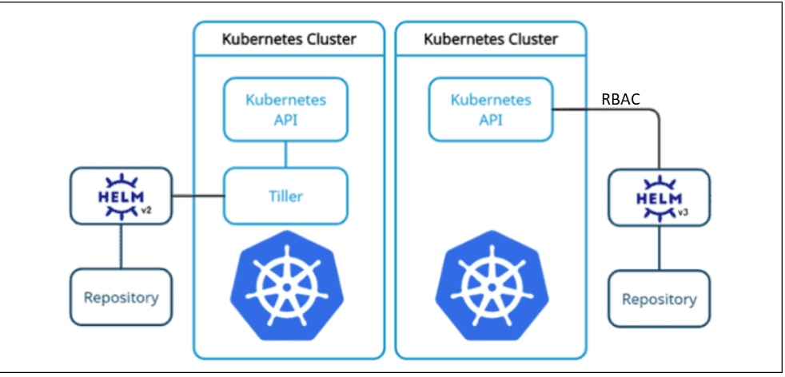

## 1. Install Helm and Configure Shell Autocompletion

Install Helm on Ubuntu:

```bash
sh <(curl -sL https://gist.githubusercontent.com/ufkunkaraman/049309d7316c539319b4376acaf42444/raw/3dcac154af60ae328d9168eca42d9dbc6da7e6e8/helm_install_ubuntu.sh)
```

Enable Bash autocompletion and create an `h` alias:

```bash
cat <<'EOF' >> ~/.bashrc
source <(helm completion bash)
alias h=helm
complete -o default -F __start_helm h
EOF
source ~/.bashrc
```

## 2. Basic Helm Usage

> [!NOTE]
> The legacy `https://charts.helm.sh/stable` repository has been deprecated in favor of Artifact Hub and vendor-maintained repositories (such as `prometheus-community` or `bitnami`).

```bash
# Add a chart repository and update local cache
helm repo add prometheus-community https://prometheus-community.github.io/helm-charts
helm repo update

# Inspect rendered Kubernetes YAML manifest for an existing release
helm get manifest -n prod <release-name>
```

## 3. Helm 3 vs Helm 2 Architecture

Helm 3 removed the in-cluster Tiller component and relies directly on Kubernetes RBAC via `kubeconfig`:


