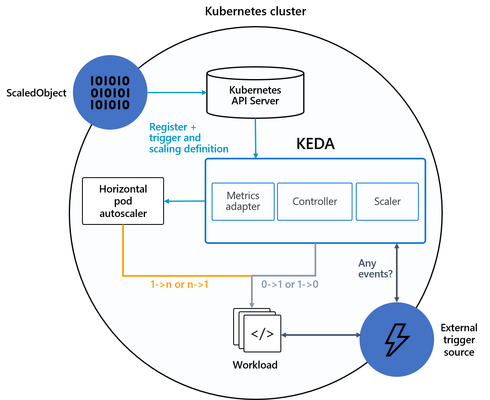
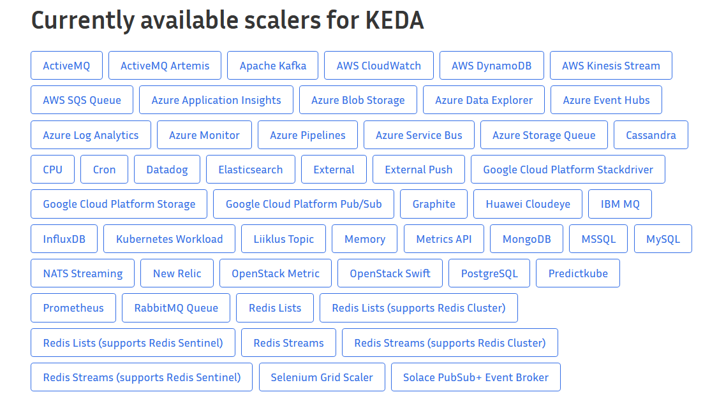

## What is KEDA?

KEDA is a Kubernetes-based Event Driven Autoscaler. With KEDA, you can drive the scaling of any container in Kubernetes based on the number of events needing to be processed.

KEDA is a single-purpose, lightweight component that works alongside standard Kubernetes Horizontal Pod Autoscalers (HPA) without overwriting or duplicating built-in behavior.

## How KEDA Works

KEDA performs two key roles within Kubernetes:

- **Agent** — KEDA activates and deactivates Kubernetes Deployments to scale to and from zero when there are no events, managed by the `keda-operator` container.
- **Metrics** — KEDA acts as a Kubernetes metrics server (`keda-operator-metrics-apiserver`) that exposes rich event data like queue length or stream lag to the HPA to drive scale-out.

## Architecture & Supported Scalers





For the latest scaler catalog, visit [keda.sh](https://keda.sh).

## KEDA Installation with Helm

### 1. Add Helm Repo

```bash
helm repo add kedacore https://kedacore.github.io/charts
helm repo update
```

### 2. Create Namespace and Install KEDA

```bash
kubectl create namespace keda
helm install keda kedacore/keda --namespace keda
```

### 3. Verify Deployment & External Metrics API

```bash
kubectl get pods -n keda
```

```text
NAME                                               READY   STATUS    RESTARTS   AGE
keda-operator-7879dcd589-fb9x8                     1/1     Running   0          17d
keda-operator-metrics-apiserver-54746f8fdc-bsrlh   1/1     Running   0          17d
```

Inspect operator logs and verify the external metrics API service:

```bash
kubectl logs -n keda keda-operator-7879dcd589-fb9x8 -c keda-operator
kubectl get apiservice v1beta1.external.metrics.k8s.io
```

### 4. Sample KEDA `ScaledObject` with Prometheus Trigger

If Prometheus was deployed using [Kubernetes Monitoring Stack](/posts/kubernetes-monitoring-stack), point `serverAddress` to its internal ClusterIP service (`monitoring-kube-prometheus-prometheus.monitoring.svc.cluster.local:9090`):

```yaml file=scaled-object-prometheus.yaml
apiVersion: keda.sh/v1alpha1
kind: ScaledObject
metadata:
  name: v2-ingress-requests
spec:
  scaleTargetRef:
    kind: Deployment
    name: hello-world
  pollingInterval: 15
  cooldownPeriod: 30
  minReplicaCount: 1  # Set to 0 to enable scale-to-zero; keep 1 for zero cold-start latency
  maxReplicaCount: 5
  triggers:
    - type: prometheus
      metadata:
        serverAddress: http://monitoring-kube-prometheus-prometheus.monitoring.svc.cluster.local:9090
        metricName: nginx_ingress_controller_requests
        threshold: "5"
        query: sum(rate(nginx_ingress_controller_requests{path="/v2"}[2m]))
```
