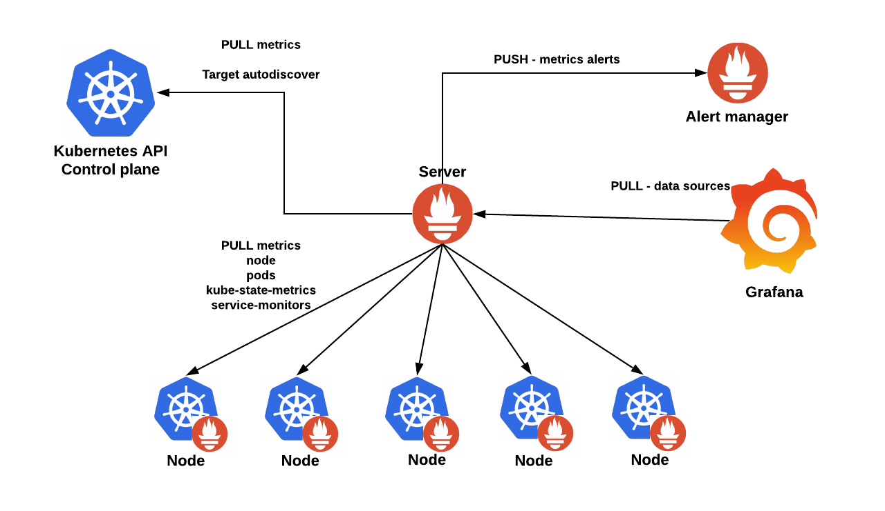

## Kubernetes Monitoring Stack Overview



### Prerequisites

Install Helm first if it is not available on your control node:

[Helm Installation and Usage](/posts/helm-installation-and-usage)

### Add Prometheus Community Helm Repository

```bash
helm repo add prometheus-community https://prometheus-community.github.io/helm-charts
helm repo update
```

### Deploy `kube-prometheus-stack` with Helm

```bash
kubectl create ns monitoring
helm install monitoring prometheus-community/kube-prometheus-stack -n monitoring

# Optional: download values.yaml to customize alerts, retention, or ingress
wget https://raw.githubusercontent.com/prometheus-community/helm-charts/main/charts/kube-prometheus-stack/values.yaml
helm install monitoring prometheus-community/kube-prometheus-stack -n monitoring -f values.yaml
```

### Verify Pods and Access Dashboards via Port Forwarding

```bash
kubectl get pods -n monitoring
```

```text
NAMESPACE       NAME                                                          READY   STATUS    RESTARTS   AGE
monitoring      alertmanager-monitoring-kube-prometheus-alertmanager-0        2/2     Running   0          5m
monitoring      monitoring-grafana-596asdsd79-pm5f6                           3/3     Running   0          5m
monitoring      monitoring-kube-prometheus-operator-qwe14dbc64-22qtl          1/1     Running   0          5m
monitoring      monitoring-kube-state-metrics-7fasdqw55b-7qk22                1/1     Running   0          5m
monitoring      monitoring-prometheus-node-exporter-2aslt                     1/1     Running   0          5m
monitoring      prometheus-monitoring-kube-prometheus-prometheus-0            2/2     Running   0          5m
```

Forward ports locally to access Grafana (`3000`), Prometheus (`9090`), and Alertmanager (`9093`):

```bash
kubectl port-forward --namespace monitoring monitoring-grafana-596asdsd79-pm5f6 3000
kubectl port-forward --namespace monitoring prometheus-monitoring-kube-prometheus-prometheus-0 9090
kubectl port-forward --namespace monitoring alertmanager-monitoring-kube-prometheus-alertmanager-0 9093
```
