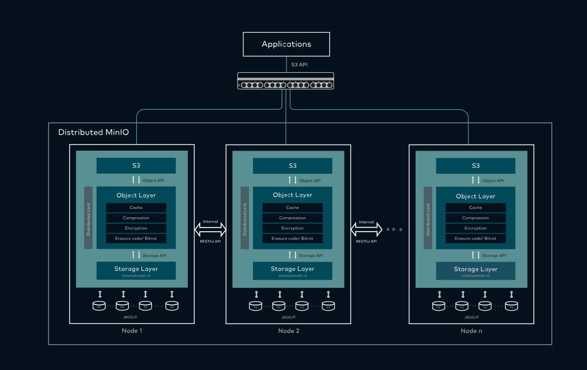
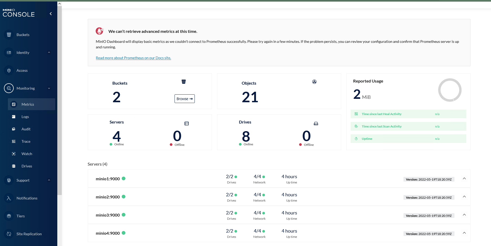

## What is MinIO?

MinIO offers high-performance, AWS S3-compatible object storage for on-premises and cloud-native environments, supporting all core S3 API features.

## MinIO Architecture

MinIO is designed to be cloud-native and runs as lightweight containers or a ~40 MB static binary with low CPU and memory overhead.



MinIO operates on commodity servers with locally attached drives (JBOD/JBOF) in a fully symmetrical architecture—no name nodes or metadata servers are required. Data and metadata are written together as objects with inline erasure coding, bitrot checks, and encryption.

## Distributed MinIO Installation with Docker Compose

### Prerequisites

- 1 VM (8 vCPU, 8 GB RAM, Ubuntu 20.04) for multi-instance MinIO lab/testing
- Working directories on the host:

```bash
mkdir -p /SETUP/minio/ && cd /SETUP/minio/
mkdir -p /data
```

### Define Docker Compose and Nginx Configuration

> [!WARNING]
> Always replace the default `MINIO_ROOT_USER` and `MINIO_ROOT_PASSWORD` (`minioadmin`) before exposing the cluster.

```yaml file=docker-compose.yaml
version: '3.7'

x-minio-common: &minio-common
  image: quay.io/minio/minio:RELEASE.2022-04-12T06-55-35Z
  command: server --console-address ":9001" http://minio{1...4}/data{1...2}
  expose:
    - "9000"
    - "9001"
  environment:
    MINIO_ROOT_USER: minioadmin
    MINIO_ROOT_PASSWORD: minioadmin
  healthcheck:
    test: ["CMD", "curl", "-f", "http://localhost:9000/minio/health/live"]
    interval: 30s
    timeout: 20s
    retries: 3

services:
  minio1:
    <<: *minio-common
    hostname: minio1
    volumes:
      - /data/data1-1:/data1
      - /data/data1-2:/data2

  minio2:
    <<: *minio-common
    hostname: minio2
    volumes:
      - /data/data2-1:/data1
      - /data/data2-2:/data2

  minio3:
    <<: *minio-common
    hostname: minio3
    volumes:
      - /data/data3-1:/data1
      - /data/data3-2:/data2

  minio4:
    <<: *minio-common
    hostname: minio4
    volumes:
      - /data/data4-1:/data1
      - /data/data4-2:/data2

  nginx:
    image: nginx:1.19.2-alpine
    hostname: nginx
    volumes:
      - ./nginx.conf:/etc/nginx/nginx.conf:ro
    ports:
      - "9000:9000"
      - "9001:9001"
    depends_on:
      - minio1
      - minio2
      - minio3
      - minio4
```

Create `nginx.conf` (update `server_name s3.devops.example.com;` to match your domain):

```nginx file=nginx.conf
user  nginx;
worker_processes  auto;

error_log  /var/log/nginx/error.log warn;
pid        /var/run/nginx.pid;

events {
    worker_connections  4096;
}

http {
    include       /etc/nginx/mime.types;
    default_type  application/octet-stream;

    log_format  main  '$remote_addr - $remote_user [$time_local] "$request" '
                      '$status $body_bytes_sent "$http_referer" '
                      '"$http_user_agent" "$http_x_forwarded_for"';

    access_log  /var/log/nginx/access.log  main;
    sendfile        on;
    keepalive_timeout  65;

    upstream minio {
        server minio1:9000;
        server minio2:9000;
        server minio3:9000;
        server minio4:9000;
    }

    upstream console {
        ip_hash;
        server minio1:9001;
        server minio2:9001;
        server minio3:9001;
        server minio4:9001;
    }

    server {
        listen       9000;
        listen  [::]:9000;
        server_name  s3.devops.example.com;

        ignore_invalid_headers off;
        client_max_body_size 0;
        proxy_buffering off;
        proxy_request_buffering off;

        location / {
            proxy_set_header Host $http_host;
            proxy_set_header X-Real-IP $remote_addr;
            proxy_set_header X-Forwarded-For $proxy_add_x_forwarded_for;
            proxy_set_header X-Forwarded-Proto $scheme;

            proxy_connect_timeout 300;
            proxy_http_version 1.1;
            proxy_set_header Connection "";
            chunked_transfer_encoding off;

            proxy_pass http://minio;
        }
    }

    server {
        listen       9001;
        listen  [::]:9001;
        server_name  s3.devops.example.com;

        ignore_invalid_headers off;
        client_max_body_size 0;
        proxy_buffering off;
        proxy_request_buffering off;

        location / {
            proxy_set_header Host $http_host;
            proxy_set_header X-Real-IP $remote_addr;
            proxy_set_header X-Forwarded-For $proxy_add_x_forwarded_for;
            proxy_set_header X-Forwarded-Proto $scheme;
            proxy_set_header X-NginX-Proxy true;

            real_ip_header X-Real-IP;
            proxy_connect_timeout 300;

            proxy_http_version 1.1;
            proxy_set_header Upgrade $http_upgrade;
            proxy_set_header Connection "upgrade";
            chunked_transfer_encoding off;

            proxy_pass http://console;
        }
    }
}
```

### Start Cluster & Access Web Console

```bash
docker-compose up -d
```

Access the MinIO Console at `http://x.x.x.x:9001` (`username: minioadmin`, `password: minioadmin`):



## Managing Objects with MinIO Client (`mc`)

Install `mc`:

```bash
wget https://dl.min.io/client/mc/release/linux-amd64/mc
chmod +x mc
sudo mv mc /usr/local/bin/mc
```

Configure alias and inspect cluster health:

```bash
# mc alias set <ALIAS> <ENDPOINT> <ACCESS-KEY> <SECRET-KEY>
mc alias set minioadmin http://x.x.x.x:9000 minioadmin minioadmin
# Added `minioadmin` successfully.

mc admin info minioadmin
```

Create a bucket and manage objects:

```bash
# Create bucket
mc mb minioadmin/test

# Upload object
echo "test" >> test.txt
mc cp test.txt minioadmin/test/test.txt

# List and read objects
mc ls minioadmin/test
mc cat minioadmin/test/test.txt

# Remove object
mc rm minioadmin/test/test.txt
```

## Example Bucket Access Policy

Restrict an IAM user to listing `test/backups/*` and uploading/reading/deleting objects only inside `test/backups/*`:

```json file=minio-backup-policy.json
{
  "Version": "2012-10-17",
  "Statement": [
    {
      "Effect": "Allow",
      "Action": ["s3:ListBucket"],
      "Resource": ["arn:aws:s3:::test"],
      "Condition": {
        "StringLike": {
          "s3:prefix": ["backups/*"]
        }
      }
    },
    {
      "Effect": "Allow",
      "Action": [
        "s3:AbortMultipartUpload",
        "s3:DeleteObject",
        "s3:GetObject",
        "s3:ListMultipartUploadParts",
        "s3:PutObject"
      ],
      "Resource": ["arn:aws:s3:::test/backups/*"]
    }
  ]
}
```

## Useful Links

- [IBM Cloud Object Storage & MinIO](https://cloud.ibm.com/docs/cloud-object-storage?topic=cloud-object-storage-minio)
- [MinIO Client (`mc`) Reference](https://docs.min.io/minio/baremetal/reference/minio-mc.html)
- [Deploy MinIO on Docker Compose](https://docs.min.io/docs/deploy-minio-on-docker-compose.html)
